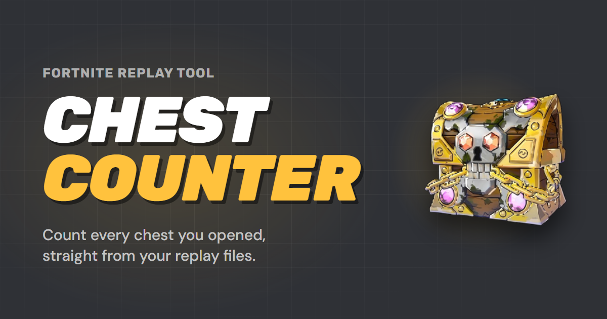
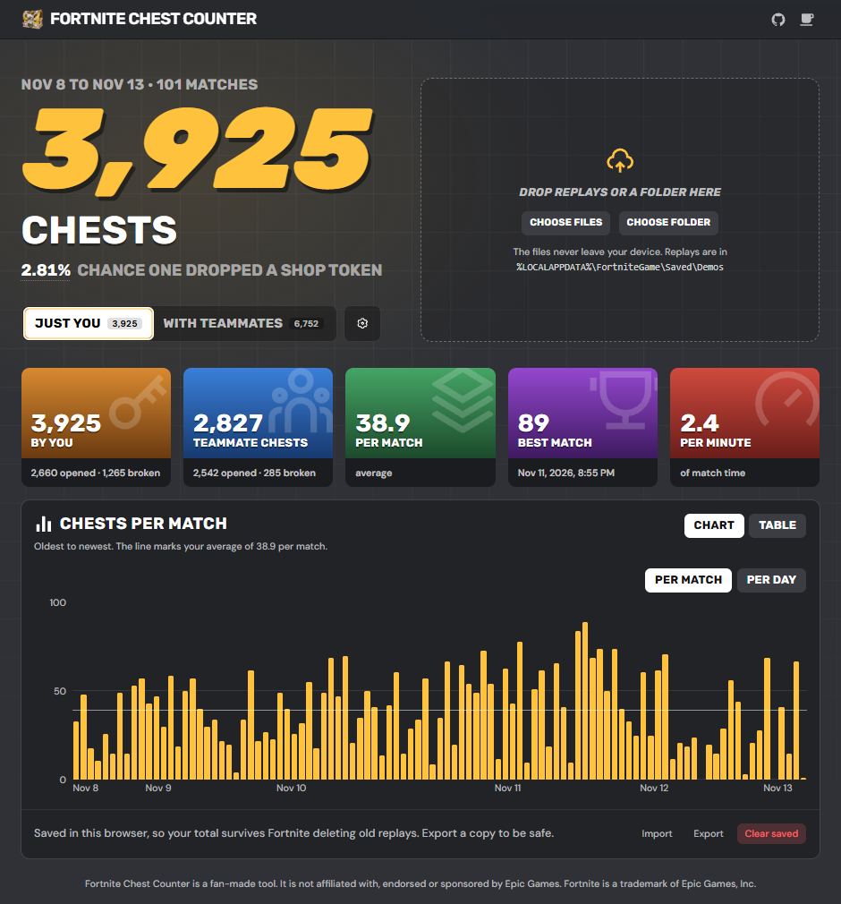
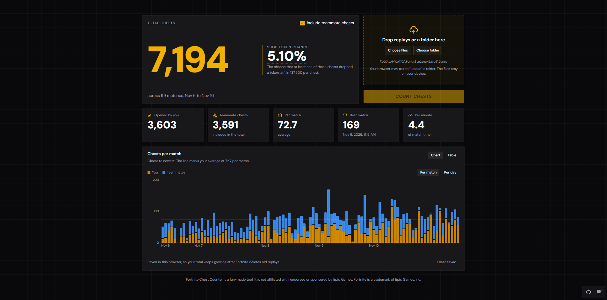

# Fortnite Chest Counter



Counts the chests you opened in Fortnite by reading your replay files, and works out your chance of having received the event's shop token.

Everything runs in your browser. Your replays are read on your own computer and are never uploaded.



With teammate chests included, the total, the token chance and the chart all add them in:



## Using it

1. Open the site on a PC. Fortnite only saves replay files on PC.
2. Press **Choose folder** and pick `%LOCALAPPDATA%\FortniteGame\Saved\Demos`, or drop replay files onto the page.
3. Press **Count chests**.

Counted matches are saved in your browser, so the total keeps growing after Fortnite deletes old replays (it keeps about the newest 100). Come back, pick the folder again, and only the new matches are read. Press **Export** to save them to a `.json` file, and **Import** to load that file in another browser or after clearing your browser data.

## What the numbers mean

- **Total chests** counts chests you opened and chests you broke without opening.
- **Teammate chests** only includes chests your teammates opened near you. A replay records what happened around the player who recorded it, so the real number is probably higher.
- **Shop token chance** is the chance that at least one counted chest dropped a token, at 1 in 137,500 per chest: `1 − (137,499 / 137,500)^chests`. Every chest is its own roll, so 137,500 chests gives about 63%, not a guarantee.

## Limits

- PC only. Console and mobile players have no replay files to read.
- A Fortnite update can change the replay format. Replays from a new version may fail until the replay library supports it.
- A replay that takes longer than 20 seconds to read is skipped and not tried again until you press **Clear saved**.

## How it works

The replay reader is C# ([`wasm/`](wasm/), using the [FortniteReplayReader](https://www.nuget.org/packages/FortniteReplayReader) package) compiled to WebAssembly. The page is React, TypeScript and Vite with shadcn/ui components.

| Part | Where |
|---|---|
| Replay reader, exposed to JavaScript as `Api.Count` | [`wasm/`](wasm/) |
| Runs the reader in a Web Worker, one fresh worker per replay | [`src/lib/parser.ts`](src/lib/parser.ts), [`src/lib/parser.worker.ts`](src/lib/parser.worker.ts) |
| Saved matches (localStorage) | [`src/lib/saved-matches.ts`](src/lib/saved-matches.ts) |
| Totals, averages, chart data, token chance | [`src/lib/stats.ts`](src/lib/stats.ts) |
| Page | [`src/App.tsx`](src/App.tsx), [`src/components/`](src/components/) |

## Running it locally

You need Node.js and the [.NET 10 SDK](https://dotnet.microsoft.com/download).

```
npm install
npm run build:wasm
npm run dev
```

`build:wasm` compiles the C# and copies the result into `public/_framework`, which is git-ignored. Run it again whenever you change anything in `wasm/`.

Other commands: `npm run build` (production build), `npm run lint`.

## Deploying

The site deploys on Vercel. [`vercel-build.sh`](vercel-build.sh) installs the .NET SDK on the build machine, builds the WebAssembly, and then builds the site.

## License

The code in this repository is licensed under the [GNU Affero General Public License v3.0](LICENSE). If you copy or change it, including to run it as a website, you must publish your source under the same license.

Some things used here are not covered by that license and stay under their own terms:

- **Icons** are from [Remix Icon](https://remixicon.com), licensed under the Remix Icon License v1.0.
- **The chest artwork** in the favicon and preview image belongs to Epic Games.
- **The replay reader** is the [FortniteReplayReader](https://www.nuget.org/packages/FortniteReplayReader) library, MIT licensed.

## Not affiliated with Epic Games

Fortnite Chest Counter is a fan-made tool. It is not affiliated with, endorsed or sponsored by Epic Games. Fortnite is a trademark of Epic Games, Inc.
